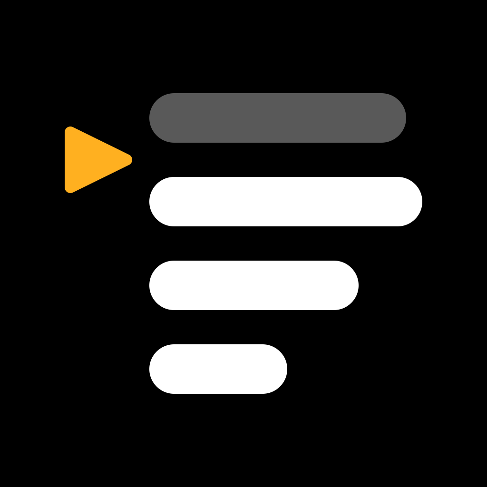
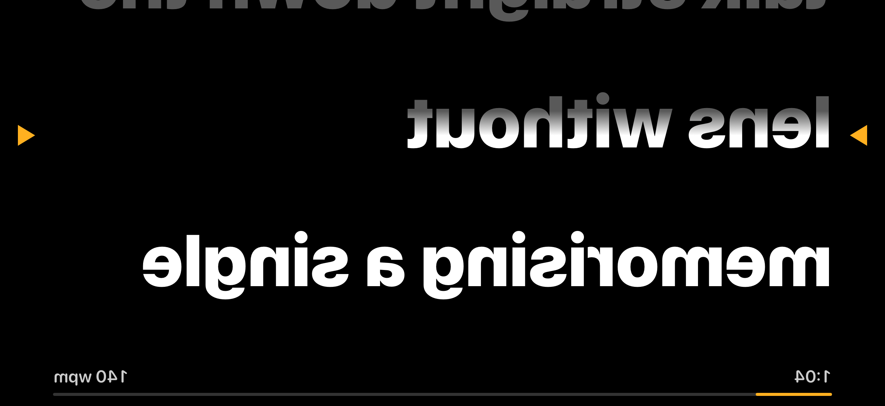
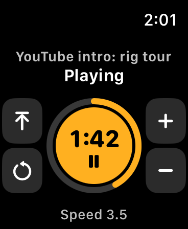
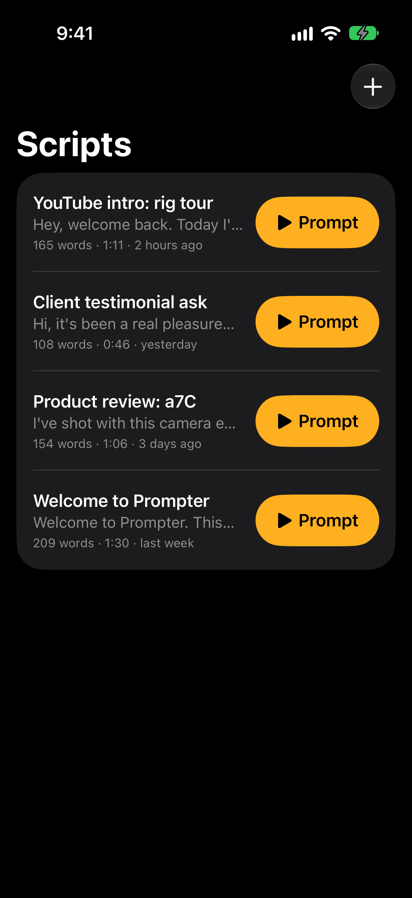
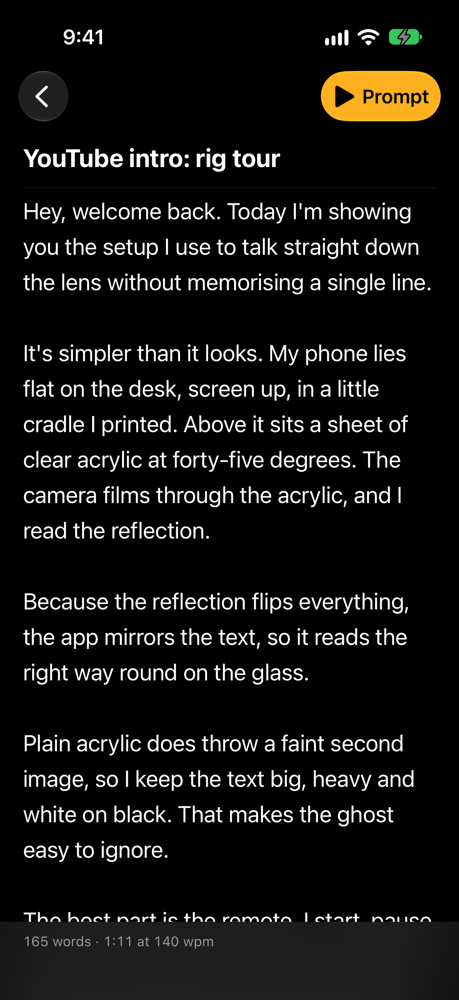
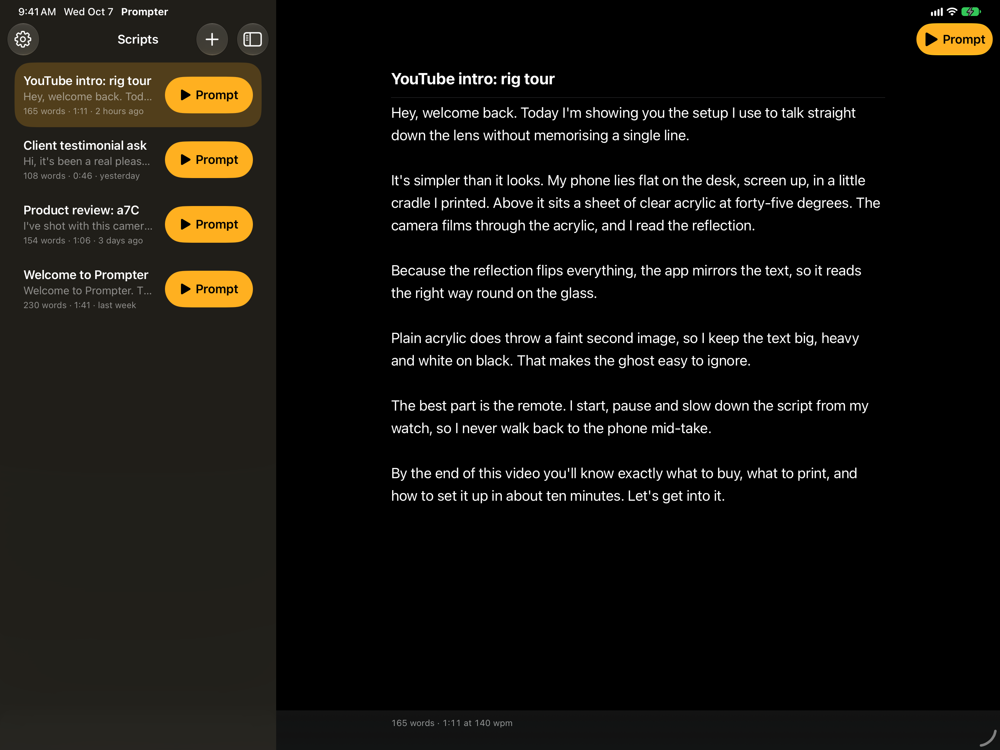
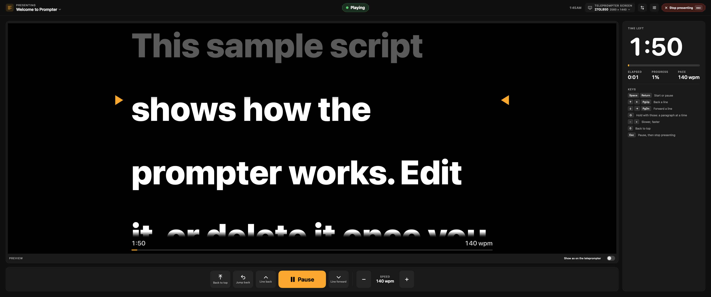

<!-- prettier-ignore -->
<div align="center">



# Prompter

*A native teleprompter for iPhone, iPad and Mac, with an Apple Watch remote*

[](#requirements)
[](#requirements)
[](#requirements)
[](https://www.swift.org)
[](LICENSE)

[Features](#features) • [Getting started](#getting-started) • [Using it](#using-it) • [Prompter for Mac](#prompter-for-mac) • [Development](#development) • [Guide](docs/guide.md)

</div>

Prompter is built for a **beam-splitter rig**: the phone lies flat under a sheet of glass or acrylic at 45°, you read the
reflection, and the camera films through the glass. You start, pause and change the speed from your wrist while you stand at
the camera. No accounts, no subscription, no ads, no analytics, and nothing leaves your devices.

<div align="center">
  
  
</div>

> [!NOTE]
> **Why it exists:** most teleprompter apps put mirroring, the watch remote or precise speed control behind a monthly
> subscription. Prompter has no subscription, and building it yourself from this repo gets you every feature for free.
>
> **App Store:** Prompter is coming to the App Store as a free download with an optional one-time Pro unlock and no
> subscription. It is not listed yet. Until then, you can build it yourself from this repo, as described below.

## Features

- **Mirrored for glass rigs**: on by default, with an optional upside-down flip and rotation by 0/90/180/270°. The landscape
  side locks for the whole take, so picking the phone up never turns the text over.
- **Readable through the ghosting**: plain acrylic reflects twice, so the defaults are big, heavy, widely spaced white text on
  pure black (72 pt Heavy, 1.6× line spacing). Size, weight, spacing, margins and colors are all adjustable.
- **Apple Watch remote**: Start with a countdown, Pause, Resume, the Digital Crown for speed, Back to top and Jump back, with
  a haptic tap on every countdown second.
- **Four ways to pace a take**: a speed from 1 to 10, **Finish in** a set time, **words per minute**, or **Voice-follow**,
  which moves the text as you read and waits when you stop. Speech recognition runs on the device.
- **Made for the moment you hit record**: a countdown of 3 to 15 s to walk to the camera, 120 Hz scrolling, a reading line a
  third of the way down with passed text dimmed, and a mirrored status bar with the time left.
- **Control it however you like**: touch, Bluetooth clickers and keyboards, Siri, Shortcuts and the Action button.
- **Scripts your way**: write, paste, or import `.txt`, `.md`, `.rtf` and `.pdf`. Markdown formatting, `// notes` and
  `[pause 3]` lines, and a word count and read time for every script.
- **Prompter for Mac**: the same prompter full screen on a teleprompter screen over HDMI, a Presenter view on the laptop, and
  scripts that sync with the iPhone.

<div align="center">
  
  
  
</div>

## Getting started

### Requirements

| What | Version |
| --- | --- |
| A Mac with **Xcode 27** or later | Use a release Xcode, not a beta, if you want TestFlight |
| [XcodeGen](https://github.com/yonaskolb/XcodeGen) | `brew install xcodegen`. It generates the Xcode project from `project.yml` |
| iPhone or iPad | iOS / iPadOS 26 or later |
| Apple Watch (optional) | watchOS 10 or later, paired with the iPhone |
| A Mac for Prompter for Mac (optional) | macOS 26 or later |
| An Apple ID | A free one (Personal Team) works, but installs expire after 7 days. A paid Developer Program membership lasts a year and adds TestFlight |

### Install on your iPhone

1. Install Xcode, open it once, and sign in under **Xcode → Settings → Accounts**.
2. Get the code and add your signing details:

   ```bash
   git clone https://github.com/superalex051/prompter.git
   cd prompter
   cp Config/Local.xcconfig.example Config/Local.xcconfig
   ```

   In `Config/Local.xcconfig`, set `DEVELOPMENT_TEAM` to your 10-character Team ID and `BUNDLE_ID_PREFIX` to something
   unique to you, such as `com.yourname`. The committed default prefix is `com.example`, which Apple will not register for
   a device install. The file is git-ignored, so your details never get committed.
3. Generate the project and open it:

   ```bash
   xcodegen generate
   open Prompter.xcodeproj
   ```

4. Plug in the iPhone and turn on **Developer Mode** (Settings → Privacy & Security). In Xcode, pick the **Prompter** scheme
   and your iPhone, then press **Run** (⌘R).

> [!TIP]
> Can't find your Team ID, or using a free Apple ID? The guide covers
> [finding it](docs/guide.md#2-get-the-code-and-set-your-signing-details), trusting the app on the phone, and
> [installing the Apple Watch app](docs/guide.md#4-install-on-your-apple-watch-optional).

> [!IMPORTANT]
> Run `xcodegen generate` again after every `git pull`, and after any change to `project.yml` or `Config/Local.xcconfig`.
> The `.xcodeproj` is generated and not stored in git.

## Using it

1. The library starts with a sample script, **Welcome to Prompter**, that walks you through the controls.
2. Hold the phone the way it sits in the rig and tap **Prompt** on a script. The landscape side locks at that moment.
3. Tap the screen, or the big button on the watch, to start the countdown. If the text is upside down in the glass, set
   **Settings → Rotation → 180°**.

| To | Touch | Keyboard or clicker | Apple Watch |
| --- | --- | --- | --- |
| Start, pause, resume | Tap | Space or Return | Big round button |
| Change the speed | | + / − | Digital Crown, or + / − |
| Move a line | Drag to scrub | ↑ ↓ ← → or Page Up / Page Down | |
| Move a paragraph | | Shift with those keys | ↺ jumps back to the paragraph start |
| Back to the top | | 0 | ⤒ |
| Change the text size | Pinch | | |
| Open settings | Long-press or two-finger tap | | |
| Close the prompter | ✕ in the corner | Esc | |

Open the prompter on the iPhone before you open Prompter on the watch. Scripts can carry a little markup:

```text
# Cold open                          ← a heading: amber, not read or counted
Most people **freeze** on camera.    ← Markdown: bold shows in amber
// Smile, look at the lens           ← a note for you: dimmed, not read or counted
[pause 2]                            ← holds the text for 2 seconds
```

The guide has the details on [pace modes](docs/guide.md#pace-modes-settings--scrolling),
[Voice-follow](docs/guide.md#voice-follow), [Markdown](docs/guide.md#markdown-formatting) and
[Siri and the Action button](docs/guide.md#siri-shortcuts-and-the-action-button).

## Prompter for Mac

Prompter for Mac puts the text full screen on a teleprompter screen connected over HDMI and gives you a **Presenter view** on
the laptop: a live preview, the time left, and big Start, Pause and speed controls. Scripts sync with the iPhone over your own
network, and your Apple Watch can drive the Mac through the iPhone.

<div align="center">
  
</div>

It needs no Apple ID, because the build is signed to run locally on your Mac:

```bash
scripts/build-mac.sh
open build/DerivedData/Build/Products/Debug/Prompter.app
```

Or choose the **PrompterMac** scheme in Xcode and press Run. Then:

1. Connect the teleprompter screen and set it to **extend**, not mirror, in System Settings → Displays.
2. Pick a script and press **Prompt** (⌘↩). The text goes to the external screen and the Presenter view fills the laptop.
3. To sync with the iPhone, click **Pair an iPhone** on the Mac (Settings → iPhone), then on the iPhone open Settings →
   **Sync with Mac**, tap your Mac and type the 12-digit code.

> [!WARNING]
> Build the Mac and iPhone apps from the same version of the code. An app that is a version behind says so instead of
> syncing.

Presenter keys, the Apple Watch as a Mac remote, one-screen mode and sync troubleshooting are in the
[guide](docs/guide.md#prompter-for-mac).

## Privacy

- No accounts, analytics, ads, tracking or servers. Scripts stay on the device, and settings in its preferences.
- **Mac sync** is optional. It sends scripts only to the Mac you pair, directly over your network, encrypted with TLS and a key
  made at pairing.
- **Voice-follow** recognizes speech on the device. Audio and text are never recorded or sent anywhere, and the microphone is
  only requested when you choose Voice mode.
- The privacy manifests declare no tracking and no collected data.

## Development

SwiftUI and Swift 6 with strict concurrency, using only Apple frameworks: no third-party code in the apps. UIKit and TextKit 2
render the scrolling text, `CADisplayLink` drives the timing, WatchConnectivity links the watch, and Voice-follow uses
SpeechAnalyzer with an SFSpeechRecognizer fallback. The Xcode project is generated by XcodeGen from `project.yml`, and the
tests use Swift Testing.

```text
Prompter/          iPhone and iPad app (library, editor, prompter, settings, App Intents)
PrompterWatch/     watchOS remote
PrompterMac/       Mac app (library, editor, Settings, output window, Presenter view)
Core/              shared by the iPhone and Mac apps: models, store, importer, scroll engine, text layout, sync
Shared/            compiled into every app: the watch-phone protocol, status, time formatting
PrompterTests/     iPhone unit tests
PrompterMacTests/  Mac unit tests
CoreTests/         tests of Core/, run on both platforms
qa/                Maestro UI flows for the simulator
Config/            signing: Signing.xcconfig plus your git-ignored Local.xcconfig
scripts/           build, test, QA, screenshots, end-to-end checks, archive, deploy, icons
website/           the project website (has its own AGENTS.md)
docs/              guide, design spec, feature research, plans, progress log, screenshots
```

```bash
xcodegen generate       # regenerate Prompter.xcodeproj after adding files or changing project.yml / Config
scripts/build.sh        # build the iPhone app (with the embedded watch app) for the simulator, no signing
scripts/test.sh         # iPhone unit tests on the "Prompter Dev iPhone" simulator (SIM="<name>" to override)
scripts/build-mac.sh    # build Prompter for Mac, signed to run locally
scripts/test-mac.sh     # Mac unit tests
scripts/qa.sh [flow…]   # Maestro UI flows in qa/ on a simulator
scripts/sim-shot.sh <name> 3 -- -demoData -route prompter -autoStart   # screenshot on a simulator
scripts/watch-e2e.sh    # watch ↔ phone end to end on paired simulators
scripts/sync-e2e.sh     # Mac ⇄ iPhone sync end to end (Mac app + iPhone simulator, over loopback)
scripts/watch-mac-e2e.sh  # Apple Watch → iPhone → Mac end to end
DEPLOY_HOSTS="" scripts/deploy-mac.sh   # build main, install Prompter for Mac in /Applications (DEPLOY_HOSTS is required: "" = this Mac only)
scripts/heavy.sh --task <ID> -- <command>   # one-at-a-time lock for builds and simulator runs, so jobs don't pile up
scripts/check-public.sh # fail if a private term is about to be published
```

> [!NOTE]
> The simulator needs no signing and nothing in `Config/Local.xcconfig`. The scripts read each app's bundle ID from the
> built app and the Maestro flows take it as `${APP_ID}`, so any `BUNDLE_ID_PREFIX` works. The scripts look for simulators
> named `Prompter Dev iPhone`, `Prompter Dev iPad` and `Prompter Dev Watch`; create them in Xcode (or with `xcrun simctl create`)
> or pass `SIM="<name>"` / `SIM_UDID=<udid>`.

<details>
<summary><b>Debug launch options</b> for screenshots and tests</summary>

Debug builds only: a Release build reads no launch arguments at all.

- `-demoData` uses a throwaway library and settings, so your real ones are untouched.
- `-route library|editor|prompter|settings|prompterSettings` opens a screen at launch.
- `-autoStart` starts the countdown on open.
- `-script sample` targets the sample script.
- On the Mac (see `PrompterMac/Features/Prompter/PresenterLaunchOptions.swift`): `-demoData -route prompter -outputScreen 1
  -autoStart -snapshot <dir> -quitAfter 10`, `-singleScreen`, `-presenterSettings`, `-route settings -settingsTab iphone`.
- On the watch: `-demoStatus playing` (and other states) and `-remoteScript "start@6,pause@18"`.

</details>

## Docs

- [Contributing](CONTRIBUTING.md) and [AGENTS.md](AGENTS.md), the briefing for AI coding agents working in this repo.
- [Guide](docs/guide.md): full install steps for iPhone and Apple Watch, every control, Prompter for Mac, sync, TestFlight
  and troubleshooting.
- [TestFlight checklist](docs/testflight-checklist.md): sharing builds with other people, with first-upload gotchas.
- [Design spec](docs/superpowers/specs/2026-10-06-prompter-design.md) and [feature research](docs/research/2026-10-06-teleprompter-feature-research.md):
  what is in, what is out, and why.
- [Progress log](docs/PROGRESS.md): what was built in each milestone and how it was verified.
- [QA flows](qa/README.md): how the simulator UI checks run.

## License

Prompter is free software under the GNU General Public License version 3. See [LICENSE](LICENSE) for the terms and
[NOTICE](NOTICE) for the copyright holder, the earlier MIT releases, and the rules for the Prompter name and icon.
The Prompter name and icon are not covered by the GPL. Earlier versions were published under the MIT License.

## How this was built

Prompter was built by AI coding agents (Claude Code), milestone by milestone. Each milestone has a written plan, unit tests,
simulator UI flows with screenshots, an independent code review and a commit. The plans, reviews and verification notes are in `docs/`.
